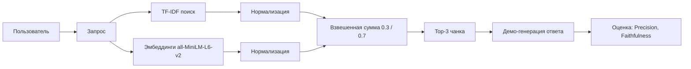

# RAG Docs Assistant

RAG-система (Retrieval-Augmented Generation) для ответов на вопросы по документации.

## Архитектура
1. Индексация: документы разбиваются на чанки, для каждого создаётся эмбеддинг.
2. Поиск: по запросу пользователя находится top-K релевантных чанков.
3. Генерация: ответ генерируется на основе найденных чанков (в демо-режиме — шаблон).

## Что внутри
- data/docs/ — тестовые документы (3 файла).
- src/rag.py — скрипт для индексации, поиска и генерации.
- results/ — примеры ответов с указанием источников.

## Как запустить
python src/rag.py

## Режимы
- Demo — поиск по TF-IDF (без внешних API), генерация по шаблону.
- Live — с реальными эмбеддингами и LLM (требуется ключ).

## Метрики
- Точность контекста — доля релевантных чанков в выдаче.
- Полнота контекста — доля найденных релевантных чанков.

## Автор
redsea1970

## Оценка

Скрипт `src/evaluate_rag.py` считает две метрики на 5 тестовых вопросах:

| Запрос | Precision | Faithfulness |
|---|---|---|
| Как создать функцию в Python? | 1.00 | 0.60 |
| Как создать ветку в Git? | 1.00 | 0.60 |
| Как собрать Docker образ? | 1.00 | 0.75 |
| Как обработать исключение? | 0.00 | 0.00 |
| Как отправить изменения в удалённый репозиторий? | 1.00 | 0.50 |
| **Среднее** | **0.80** | **0.49** |

## Ограничения

- Гибридный поиск использует `all-MiniLM-L6-v2` — **англоязычную** модель эмбеддингов. На русском тексте она работает слабо: запрос «Как обработать исключение?» не находит раздел `try/except` в `python.md` (Precision = 0.00).
- TF-IDF не учитывает морфологию русского языка: «исключение» и «исключения» — разные токены.
- Для production нужно: заменить модель на русскоязычную (например, `cointegrated/rubert-tiny2`), добавить стемминг/лемматизацию, провести оценку на расширенном наборе вопросов.

## Архитектура

## Архитектура

Подробная схема проекта: [ARCHITECTURE.md](ARCHITECTURE.md)
